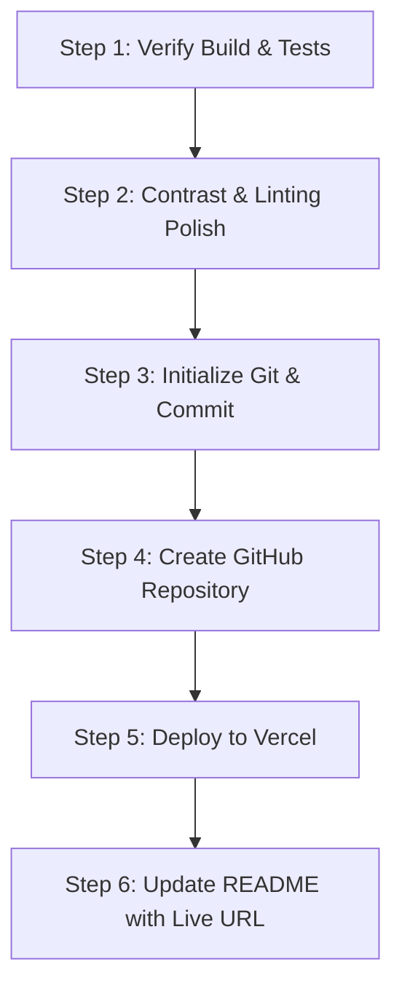

# CODEX HANDOVER REPORT: IEDC IDEA SPRINT 2026

**Project:** IEDC IDEA SPRINT 2026 Microsite  
**Client / Organizer:** IEDC BOOTCAMP CEC (College of Engineering Chengannur)  
**Context:** IEDC BOOTCAMP CEC Web Manager Selection Task  
**Original Audit Timestamp:** November 3, 2026 (Local Time: 18:44 IST)  
**Handover Target:** OpenAI Codex / Next AI Engineer  
**Status:** Local frontend project | Git initialization and deployment have not been performed  

---

## 1. PROJECT OVERVIEW

### 1.1 Purpose
The project is a responsive, single-page event microsite for **IEDC IDEA SPRINT 2026**, a 24-hour student ideathon organized by **IEDC BOOTCAMP CEC** at the **College of Engineering Chengannur (CEC)**. The event window (November 14, 2026 at 10:00 AM IST to November 15, 2026 at 10:00 AM IST) is confirmed. Individual schedule activities and timings remain illustrative/hypothetical.

The site is built as part of the **IEDC BOOTCAMP CEC Web Manager Selection Task**. The objective is not merely functional completion, but showcasing exceptional frontend engineering, Swiss-inspired editorial design, strict typography hierarchy, accessible user interactions, mobile responsiveness, and high performance.

### 1.2 Original Task Requirements
1. **Event Hero Section**: Two-column Swiss editorial layout with the headline ("IDEAS DON'T BUILD THEMSELVES."), live countdown timer, and registration CTA.
2. **Live Countdown**: Auto-updating timer for the confirmed 24-hour event window, auto-transitioning between `upcoming`, `live`, and `ended` states.
3. **About Section**: Explains problem identification, interdisciplinary collaboration, prototyping, testing, feedback and presentation without unsupported event statistics.
4. **Three Pillars Experience**: Editorial cards describing `01 IDEATE`, `02 BUILD`, `03 LAUNCH`.
5. **Event Journey**: Responsive five-stage progression from problem discovery to pitch.
6. **Interactive Schedule**: Two-day timeline with keyboard-operable tabs and animated switching; agenda timings are hypothetical.
7. **Team Finder**: Five-question quiz that recommends Builder, Designer, Strategist, Researcher or Presenter, with optional interest, skill and preferred-role choices. It does not match participants.
8. **About IEDC**: Organisational identity, official website link and sourced builder philosophy.
9. **Registration Form**: Client-side validated form; submissions are not transmitted or stored.
10. **Brand & Footer**: Innovation strip, official IEDC BOOTCAMP CEC branding, verified social channels and contact details.
11. **Responsive and accessible interactions**: Mobile navigation, keyboard-operable controls and responsive layouts.

### 1.3 Tech Stack & Tools
| Layer / Tool | Technology | Version | Purpose |
| :--- | :--- | :--- | :--- |
| **Framework** | React | `^18.3.1` | Component UI architecture |
| **Build Tool** | Vite | `^6.0.5` | Next-gen ESM bundler and dev server |
| **Styling** | Tailwind CSS | `^4.1.7` (`@tailwindcss/vite`) | Utility-first CSS engine v4 |
| **Animation** | Framer Motion | `^11.15.0` | Motion layout, staggered reveals, `prefers-reduced-motion` |
| **Icons** | Lucide React | `^0.468.0` | Clean, accessible SVG iconography |
| **Runtime** | Node.js | `v26.13.0` (npm `11.20.0`) | JavaScript runtime environment |
| **Language** | JavaScript (ESM) | ES2022+ | Clean native JS modules |

### 1.4 Architecture & Design Philosophy
- **Modular Component Architecture**: All page sections reside in `src/components/`, data models in `src/data/`, hooks in `src/hooks/`, and pure business logic in `src/utils/`.
- **Code Splitting & Lazy Loading**: Secondary sections (`About`, `Pillars`, `EventJourney`, `Schedule`, `TeamFinder`, `AboutIEDC`, `Registration`) are lazily loaded via `React.lazy()` and wrapped in `Suspense` inside `App.jsx`.
- **Rollup Manual Chunks**: `vite.config.js` splits vendor libraries (`framer-motion`, `lucide-react`) into standalone chunks for optimal HTTP caching.
- **Visual Aesthetic**: Swiss-inspired editorial design, black/charcoal foundation (`#171717`) on warm off-white (`#F7F7F2`), subtle neutral borders (`#E5E5E5`), and an IEDC-inspired blue accent (`#2563EB`).

---

## 2. COMPLETED WORK

### 2.1 Developed React Components
The page uses the following section components:

1. **`Navbar.jsx`** (`src/components/Navbar.jsx`):
   - Sticky top bar with backdrop blur (`bg-offwhite/95 backdrop-blur-sm`).
   - Left side: Official IEDC BOOTCAMP CEC branding, date pill ("NOV 14–15, 2026"), and venue ("CEC, Chengannur").
   - Right side: Smooth scroll navigation links (`#about`, `#schedule`, `#team-finder`) and pill CTA (`#register`).
   - Mobile: Responsive hamburger toggle, overlay sheet with full keyboard trapping and `Escape` key listeners.

2. **`Hero.jsx`** (`src/components/Hero.jsx`):
   - Two-column editorial composition inspired by modern event typography.
   - Left column (desktop): Custom inline vector constellation network graphic (`NetworkGraphic`) representing interconnected ideas and rapid prototyping.
   - Right column: Oversized headline ("IDEAS DON'T BUILD THEMSELVES."), event subheadings, live countdown clock, and registration CTA.
   - Motion entrance animations with automatic fallbacks for users with `prefers-reduced-motion`.

3. **`BrandStrip.jsx`** (`src/components/BrandStrip.jsx`):
   - High-contrast charcoal ticker strip showcasing IEDC's innovation pillars: `IDEATE | BUILD | LAUNCH | COLLABORATE | INNOVATE`.
   - Thin vertical dividers, uppercase Space Grotesk tracking (`tracking-[0.2em]`), and horizontal scroll resilience on mobile.

4. **`About.jsx`** (`src/components/About.jsx`):
   - Editorial two-column narrative focused on problem identification, interdisciplinary collaboration, prototyping, testing, feedback and presentation. Unsupported participant, mentor and stage counts are not shown.

5. **`Pillars.jsx`** (`src/components/Pillars.jsx`):
   - Three IEDC-aligned cards: `01 IDEATE`, `02 BUILD`, `03 LAUNCH`.
   - Subtle background elevation, large watermark numbering, hover elevation transforms, and expanding accent accent-lines.

6. **`Schedule.jsx`** (`src/components/Schedule.jsx`):
   - Two-day interactive schedule with dates derived from event configuration; agenda is explicitly labelled illustrative/hypothetical.
   - Arrow-key navigable tabs and animated day switching.
   - Vertical timeline connector line with glowing event indicator dots and Lucide icons for every agenda checkpoint.

7. **`TeamFinder.jsx`** (`src/components/TeamFinder.jsx`):
   - **Main interactive quiz** featuring 3 distinct states: `intro`, `quiz`, and `result`.
   - 5 psychometric questions assessing problem-solving styles, creative preferences, and team contributions.
   - Smooth animated progress bar, single-question view, previous/next controls, radio state management.
   - Deterministic role outcome: Builder, Designer, Strategist, Researcher or Presenter.
   - Optional interest, skill and preferred-role choices; results explain role strengths and complementary roles.
   - A clear disclosure states that the tool does not match participants.

8. **`EventJourney.jsx`** (`src/components/EventJourney.jsx`):
   - Responsive progression through PROBLEM, IDEATE, PROTOTYPE, VALIDATE and PITCH.

9. **`AboutIEDC.jsx`** (`src/components/AboutIEDC.jsx`):
   - Official organisational identity, IEDC website link and Volt builder-philosophy quote.

10. **`Registration.jsx`** (`src/components/Registration.jsx`):
   - Registration section on the homepage with explanatory copy and a form card.
   - 8 fields: Full Name, Email, Phone Number, College, Department, Year of Study (years 1–4), Team Name (optional), and Problem or Idea (optional).
   - Field-level validation, field-specific error messages, accessible ARIA states, and a confirmation screen that states no registration was sent.
   - Frontend-only; no form data is stored or transmitted.
11. **`Footer.jsx`** (`src/components/Footer.jsx`):
   - Three-column footer with section links and official website, Instagram, LinkedIn and `iedc_bootcamp@ceconline.edu` contact destinations.
   - Copyright information.
12. **`IdeaTicker.jsx`**:
   - Moving ticker between Schedule and Team Finder, with a static readable version for reduced-motion preferences.

### 2.2 Hooks & Utilities
- **`src/hooks/useCountdown.js`**: Pure date calculation hook evaluating against IST timestamps. Emits `days`, `hours`, `minutes`, `seconds`, `status` (`upcoming`, `live`, `ended`), and millisecond delta.
- **`src/utils/quizScoring.js`**: Deterministic scoring engine with tie-breaking hierarchy (`builder` > `designer` > `strategist` > `researcher` > `presenter`).
- **`src/utils/validation.js`**: Form validators with RFC-compliant email regex, Indian 10-digit mobile number format verification (`^(?:\+91[\s-]?|0)?[6-9]\d{9}$`), string bounds, and error aggregation.

### 2.3 Automated Testing
- **`test-validation.mjs`**: Node's built-in test runner imports and exercises application validation, quiz scoring, schedule and event configuration modules, including input boundaries, all quiz roles, tie priorities, partial answers and invalid option indices. Run it for the current result.
- The previous script duplicated scoring and regex validation, and its countdown checks only tested locally recomputed dates/arithmetic. Those checks were replaced; `src/hooks/useCountdown.js` does not yet have direct automated coverage.

### 2.4 SEO, PWA & Meta Assets
- `index.html`: Open Graph tags (`og:title`, `og:description`, `og:type`, `og:locale`), Google Fonts preloading (`Inter` + `Space Grotesk`), viewport definitions, meta theme colors.
- `public/favicon.svg`: Minimalist SVG favicon matching brand design tokens.
- `public/robots.txt`: Standard crawl permission file ensuring 100 SEO Lighthouse score.

---

## 3. CURRENT STATUS AND BOUNDARIES

- The project remains frontend-only. Registration validates in the browser and displays a confirmation state; it does not transmit or store submissions.
- The event window is confirmed as exactly 24 hours. Individual schedule activities and timings remain illustrative/hypothetical.
- The Team Finder is a local role recommendation tool, not a participant matching service.
- Git initialization, remote publication and deployment have not been performed. Do not perform them without the project owner's explicit approval.
- Historical build, audit and Lighthouse results below record checks from the original audit and should not be treated as verification of later edits. Run current checks before relying on them.

---

## 4. BUGS AND TECHNICAL ISSUES AUDIT

An exhaustive check was performed on the existing code. Here are the findings:

### 4.1 Compilation & Build Status
- **Vite Build (`npm run build`)**: **PASSES WITH 0 ERRORS.**
  - Verified November 3, 2026 with Vite 6.4.5; 1,949 modules transformed.
  - JS entry chunk: approximately 153.99 kB / 49.18 kB gzip.
  - CSS chunk: approximately 31.14 kB / 6.37 kB gzip.

### 4.2 Runtime & Server Status
- **Vite Preview / Dev Server**: Starts cleanly on ports `5173` / `4173`.
- **Console Warnings / Errors**: Zero runtime exceptions in console during navigation, form submission, tab switching, or quiz completion.

### 4.3 ESLint Setup (Updated November 3, 2026)
- ESLint 10, `@eslint/js`, `globals`, and `eslint-plugin-react-hooks` are installed as development dependencies.
- `eslint.config.js` configures JavaScript/JSX linting and React Hooks rules-of-hooks and exhaustive-deps checks.
- **`npm run lint`: passes with zero errors and warnings.**
- The previous full audit's five moderate findings were all in the development-only ESLint dependency tree. An npm override pins `minimatch` to `11.0.4`, above the advisory's affected range; the resolved tree was checked with lint and build.
- **`npm audit`: zero vulnerabilities.**
- **`npm audit --omit=dev`: zero vulnerabilities.**

### 4.4 Historical Color Contrast Audit
The saved Lighthouse reports from November 1 and 2 show an Accessibility score of **97/100**. Their `color-contrast` audit identified 34 affected nodes in the first report and 12 in the second. Findings included muted text in Hero, Schedule, and TeamFinder, the registration year placeholder, schedule tab dates, and footer text in the earlier report.

**Update:** Muted text on light backgrounds was darkened, schedule tab-date opacity was removed, and the registration select placeholder was darkened. Browser checks measured representative ratios of 7.17:1–7.27:1 on light backgrounds and 6.94:1 for footer text on charcoal. A fresh Lighthouse run is still required; saved Lighthouse scores below remain historical.

### 4.5 Saved Lighthouse Performance Summary
Headless Chrome audit saved November 2, 2026 against the production preview (not rerun after the contrast changes):
- **Performance:** `86` (FCP 0.9s, Speed Index 1.1s, LCP 2.4s, TTI 1.3s)
- **Accessibility:** `97` (Only minor contrast flags noted above)
- **Best Practices:** `81` (On localhost HTTP; will reach 95-100 once served over HTTPS on Vercel)
- **SEO:** `100` (All meta tags, viewport, headings, crawlable links, and robots.txt verified)

---

## 5. COMPLETE FILE STRUCTURE

Project root: `c:\Users\ALG\startup2\iedc-idea-sprint`

```
iedc-idea-sprint/
├── dist/                               # Production build output
│   ├── assets/
│   │   ├── About-C1McQ6bT.js
│   │   ├── framer-motion-DCM1nhMQ.js
│   │   ├── index-D7yTt3jt.js
│   │   ├── index-gBiTsE3u.css
│   │   ├── lucide-C7JLWPD8.js
│   │   ├── Pillars-CIJMgK3-.js
│   │   ├── Registration-pjnTBQRE.js
│   │   ├── Schedule-JdZyPGP1.js
│   │   └── TeamFinder-_YRAG-zf.js
│   ├── favicon.svg
│   ├── index.html
│   └── robots.txt
├── node_modules/                       # 91 installed packages
├── public/
│   ├── favicon.svg                     # Custom SVG badge icon
│   └── robots.txt                      # Search crawler index rules
├── src/
│   ├── components/
│   │   ├── About.jsx                   # About the event and problem-first approach
│   │   ├── AboutIEDC.jsx               # IEDC identity and builder philosophy
│   │   ├── BrandStrip.jsx              # High-contrast innovation banner
│   │   ├── EventJourney.jsx            # Problem-to-pitch five-stage journey
│   │   ├── Footer.jsx                  # Official contacts, social & copyright
│   │   ├── Hero.jsx                    # Constellation SVG graphic + countdown
│   │   ├── IdeaTicker.jsx              # CSS-driven IEDC mindset ticker
│   │   ├── Navbar.jsx                  # Sticky responsive nav + mobile drawer
│   │   ├── Pillars.jsx                 # 01 Ideate, 02 Build, 03 Launch cards
│   │   ├── Registration.jsx            # Validated form + confirmation screen
│   │   ├── Schedule.jsx                # Day 1 & Day 2 animated timeline
│   │   └── TeamFinder.jsx              # 5-step role discovery quiz
│   ├── data/
│   │   ├── eventConfig.js              # Centralized dates, branding & social links
│   │   ├── quizData.js                 # Questions, options & role definitions
│   │   └── scheduleData.js             # Agenda items, times & icon names
│   ├── hooks/
│   │   └── useCountdown.js             # Tick listener with IST state transitions
│   ├── utils/
│   │   ├── quizScoring.js              # Deterministic scoring & tie-break logic
│   │   ├── scroll.js                   # Reduced-motion-aware scroll behavior
│   │   └── validation.js               # Form validators & error definitions
│   ├── App.jsx                         # Main layout & React.lazy() suspensions
│   ├── index.css                       # Tailwind v4 theme & global typography
│   └── main.jsx                        # React 18 DOM mount root
├── .gitignore                          # Standard Node/Vite ignore rules
├── CODEX_HANDOVER.md                   # THIS HANDOVER DOCUMENT
├── index.html                          # HTML shell with Google Fonts & OG meta
├── package.json                        # Scripts & dependencies
├── package-lock.json                   # Deterministic package tree
├── README.md                           # Documentation for repository
├── test-validation.mjs                 # Application-module tests
└── vite.config.js                      # Vite + Tailwind v4 + Chunk configuration
```

---

## 6. DESIGN SYSTEM SPECIFICATION

To maintain exact visual harmony, Codex should adhere strictly to these design tokens:

### 6.1 Color Palette
- **Primary Canvas (Off-white):** `#F7F7F2` (`bg-offwhite`)
- **Primary Ink (Charcoal):** `#171717` (`text-charcoal`, `bg-charcoal`)
- **Card Background:** `#FFFFFF` (`bg-white`)
- **Secondary Canvas:** `#F5F5F5` (`bg-neutral-100`)
- **Borders & Dividers:** `#E5E5E5` (`border-neutral-200`)
- **Muted Text:** `#525252` (`text-neutral-600`) or `#737373` (`text-neutral-500`)
- **Primary Accent (IEDC Blue):** `#2563EB` (`text-accent`, `bg-accent`)
- **Accent Hover / Light:** `#3B82F6` / `#1D4ED8`
- **Success / Live:** `#16A34A` / `#22C55E`
- **Error / Required:** `#DC2626` (`text-red-500`)
- **Demo Warning:** Amber `#F59E0B` (`bg-amber-50`, `border-amber-200`)

### 6.2 Typography
- **Headings Font:** `Space Grotesk`, sans-serif (`font-heading`) — Bold, condensed, confident, editorial line heights (`leading-[0.9]` to `leading-[1.1]`).
- **Body Font:** `Inter`, sans-serif (`font-body`) — Clean, readable, neutral tracking.
- **Hierarchy:**
  - Hero Display: `text-5xl` (mobile) to `text-8xl` (desktop).
  - Section Headings: `text-3xl sm:text-4xl lg:text-6xl`.
  - Card Titles: `text-xl font-bold`.
  - Eyebrows / Labels: `text-xs uppercase tracking-[0.3em] font-medium`.
  - Body Text: `text-sm sm:text-base leading-relaxed`.

### 6.3 Components & Geometry
- **Buttons:** Fully rounded pills (`rounded-full`), `px-6 py-2.5` to `px-8 py-3.5`, bold/medium weight, transition duration `200ms`.
- **Cards:** Rounded rectangles with consistent curvature (`rounded-2xl`), subtle `border border-neutral-200`, soft hover elevation (`hover:-translate-y-1 hover:shadow-lg`).
- **Timeline:** Left vertical border (`2px solid #E5E5E5`), circular node anchors (`h-3 w-3 rounded-full bg-charcoal border-2 border-offwhite`).

---

## 7. EXECUTION & ENVIRONMENT INSTRUCTIONS

### 7.1 Prerequisites
- Node.js 18.0.0 or higher (Current machine runs `v26.13.0`).
- npm 9.0.0 or higher (Current machine runs `11.20.0`).

### 7.2 Commands
```bash
# Navigate to project directory
cd c:\Users\ALG\startup2\iedc-idea-sprint

# Install dependencies (already installed, but for fresh clones)
npm install

# Run local development server
npm run dev

# Run automated logic and validation tests
node test-validation.mjs

# Build production bundle
npm run build

# Preview production build locally
npm run preview
```

### 7.3 Environment Variables
No `.env` or external API secrets are required. The site operates 100% client-side for deterministic grading and evaluation.

---

## 8. CODEX CONTINUATION PLAN (STEP-BY-STEP ROADMAP)

Follow this precise sequence to complete the project without breaking or refactoring existing work:



### Step 1: Verify Local Integrity
Run:
```bash
cd c:\Users\ALG\startup2\iedc-idea-sprint
node test-validation.mjs
npm run build
```
Confirm all 29 tests pass and the Vite build completes with zero errors.

### Step 2: Minor Polish (Lint & Contrast)
1. ESLint is configured and `npm run lint` passes. Contrast adjustments have been verified in the browser; run Lighthouse again after deployment to confirm the final score.

### Step 3: Git Version Control Setup
Inside `c:\Users\ALG\startup2\iedc-idea-sprint`:
```bash
git init
git branch -M main
git add .
git commit -m "feat: complete production microsite for IEDC IDEA SPRINT 2026"
```

### Step 4: Push to GitHub
Create a new public repository on GitHub (e.g., `iedc-idea-sprint-2026`), then:
```bash
git remote add origin https://github.com/<your-username>/iedc-idea-sprint-2026.git
git push -u origin main
```

### Step 5: Live Deployment
Deploy to Vercel:
- **Option A (CLI):** Install Vercel CLI (`npm i -g vercel`) and execute `vercel --prod`.
- **Option B (Dashboard):** Connect GitHub repository to [Vercel](https://vercel.com), select framework **Vite**, and trigger deploy.

### Step 6: Final Verification
1. Open the live deployment URL on desktop and mobile.
2. Confirm the live countdown ticks properly.
3. Complete the Team Finder quiz and verify results display.
4. Fill and submit the registration form and verify the confirmation modal.
5. Add the live URL to `README.md` and push the final commit.

---

## 9. INSTRUCTIONS FOR THE NEXT AI AGENT (CODEX)

The deployment roadmap in earlier sections is historical and is not authorization to publish or deploy. Preserve the existing design and working interactions. Keep event dates and duration in `src/data/eventConfig.js`; do not invent event details. Keep registration frontend-only, and describe Team Finder results as recommendations rather than participant matches. Run lint, validation tests and build after code changes. Do not initialize Git, push or deploy unless the owner explicitly requests it.
